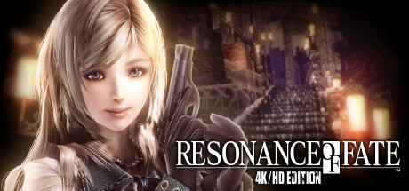

**Resonance of Fate is the unique mechanical JRPG where combat revolves entirely around gun-based acrobatic combat, with heroes leaping and sliding to build tricolor energy for Tri-attacks. Set in a dying world where humanity survives in a massive mechanical tower.**

---

## 📖 About

Resonance of Fate is the unique mechanical JRPG where combat revolves entirely around gun-based acrobatic combat, with heroes leaping and sliding to build tricolor energy for Tri-attacks. Set in a dying world where humanity survives in a massive mechanical tower.

## ⚠️ Problems Without Trainer

| Problem | Status |
|---------|--------|
| **Mechanical Combat** — Unique gun combat system has extremely high learning curve | ✅ Solved |
| **Charge Gauge Management** — Running out of Charge makes characters nearly useless in combat | ✅ Solved |
| **Hex Map Completion** — Clearing all hex tiles on the world map requires extensive resource investment | ✅ Solved |
| **Boss Endurance** — Late bosses have enormous health pools requiring sustained Tri-attack chains | ✅ Solved |

## ✅ Solution

The **Resonance of Fate Trainer** solves all these issues by giving you complete control over the game.

## 🎯 Full Feature List

- Unlimited Resources
- God Mode / Invincibility
- Instant Skill Cooldown
- One-Hit Kill
- Freeze Game Timer
- Unlock All Items & Achievements
- Custom Speed Multiplier
- Save State Anywhere

## 🚀 Quick Start

1. **Disable Windows Defender** temporarily (trainer may trigger false positive)
2. Download the trainer from the button above
3. Launch Resonance of Fate
4. Run the trainer as Administrator
5. Activate desired cheats with hotkeys

## 💎 Free vs Paid

| Feature | Free | Pro |
|---------|------|-----|
| Basic God Mode | ✅ | ✅ |
| Unlimited Resources | ✅ | ✅ |
| All Advanced Cheats | ❌ | ✅ |
| Auto-Updates | ❌ | ✅ |
| Priority Support | ❌ | ✅ |

## 💻 Requirements

- Windows 10/11 (64-bit)
- Resonance of Fate (any version)
- .NET Framework 4.8+
- DirectX 11+

## 🍎 macOS

macOS users can use our alternative tool:

## ⚖️ Legal

This trainer is for educational and single-player use only. Use responsibly.

---

